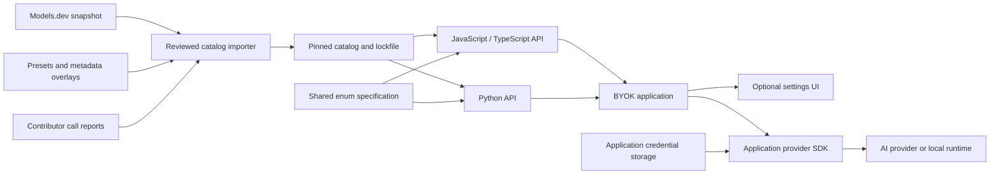
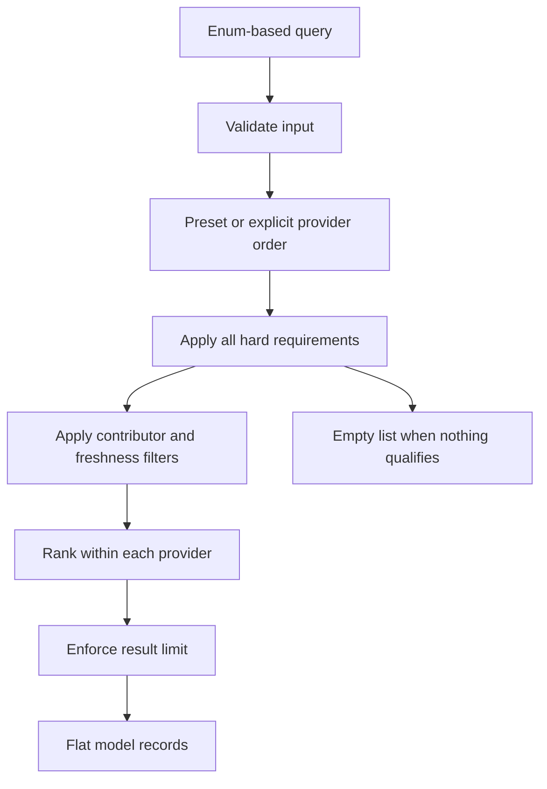
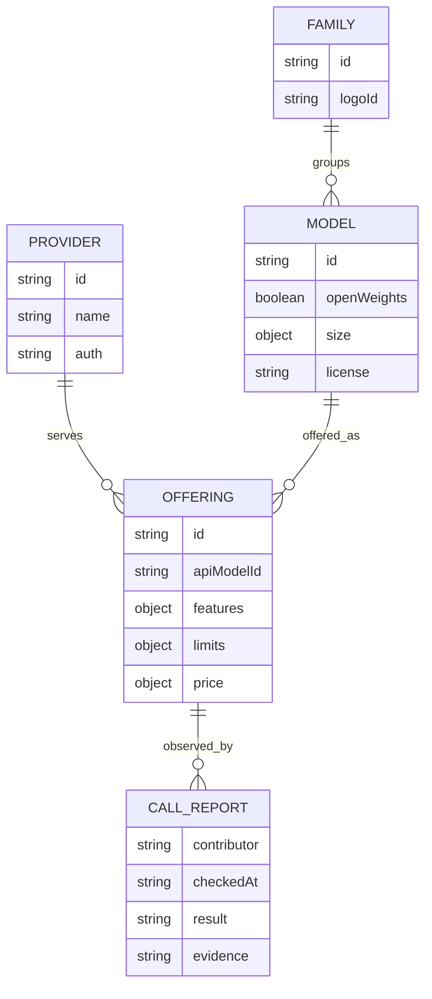
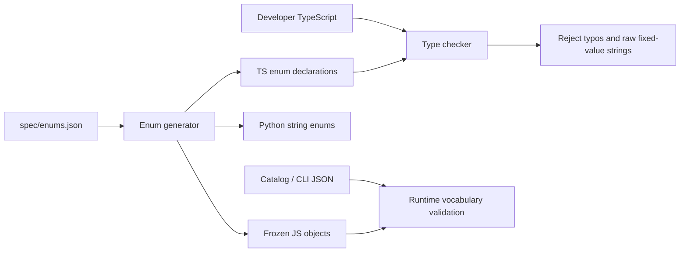
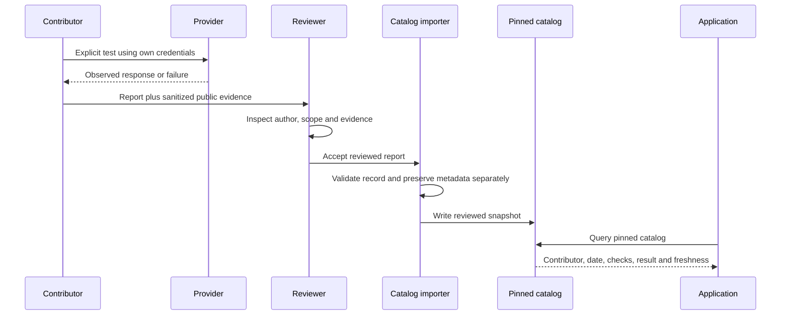
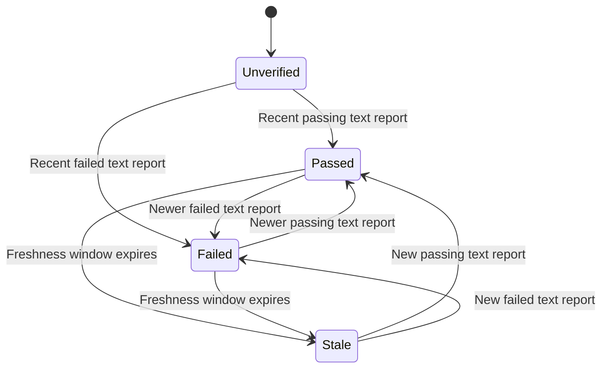

# byokit design

byokit provides lists of providers and models for BYOK applications, then refines
those lists using application filters. The API is the primary interface; a browser
settings panel is an optional consumer of the same data.

## Architecture



Models.dev supplies the broad metadata foundation. Reviewed overlays supply audience
presets and corrections; contributor reports supply evidence of particular calls.
The importer generates offline snapshots, change reports and hashes. Ordinary
queries and builds make no network requests. SDK releases and catalog revisions
can be reviewed separately.

Credentials stay in the application. Neither catalog metadata nor contributor
reports contain keys. Metadata refresh cannot launch inference, switch a saved
model, or redirect a key to a new endpoint. Native provider execution, subscription
login and quota handling belong to the application.

## Public query

```ts
import * as byokit from '@byokit/core/catalog';

const models=byokit.getModels({
  preset:byokit.Preset.NonChina,
  limit:10,
  filters:{input:[byokit.Modality.Text],requiredFeatures:[byokit.FeatureName.FunctionCalling]},
});
```

Each result is one provider/model offering enriched with provider, model, family,
logo and verification metadata. `byokit.Catalog(customData).getModels` uses another pinned
catalog. `byokit.Catalog.select` remains available for grouped menus. Python mirrors these
interfaces as `get_models` and `byokit.Catalog.get_models`.

## Selection flow



Provider order follows the preset or explicit provider list. Within a provider,
preferred supported features rank first, followed by optional input-token price,
curated rank and stable ID. `getModels` returns all matching non-deprecated catalog entries for explicit providerIds;
preset-only queries return at most ten results by default. An explicit limit caps either query.
Grouped UI menus have separate provider/model-per-provider limits.

Unknown metadata fails a requirement unless byokit.UnknownPolicy.Include permits it.
Conditional features do not satisfy unconditional requirements. Hard filters are
never relaxed to fill a list. Open weights, commercial permission, model origin,
endpoint location and account eligibility are distinct facts. Speed needs a sourced
measurement; model size does not establish speed or memory fit.

## Data relationships



The offering holds provider-specific limits, costs and capabilities. The underlying
model holds identity, openness, license, size and architecture. Local discovery
creates deployment records with known artifact details while leaving unverified
limits/capabilities unknown. Family artwork can use a provider fallback.

## Enum and build-time contract



Fixed vocabularies include providers, presets, modalities, feature names and states,
deployment, authentication, context accounting, results and verification checks.
TS declarations use actual enums so even a correctly spelled raw string is rejected
where an enum is required. JS uses frozen objects with the same members and values.
Python uses str/Enum subclasses and a typed query configuration for type checkers.
JSON persists values as strings and is checked at runtime.

Open data such as model IDs, URLs, notes and custom tags cannot be exhaustively
listed in a permanent enum. Explicit branded helpers cover custom providers,
country codes, file formats, tags and contributor handles. Builds also emit runtime
OfferingId/ModelId enums and capability-specific ID enums for their pinned catalog.
Invalid enum members are compile-time errors; numeric token budgets need separate
build/runtime checks. Types cannot establish account access or dynamic request fit.

## Capability and context checks

Features use supported/unsupported/conditional/unknown with evidence. Text JSON is
separate from strict schema enforcement, and cache pricing is separate from cache
controls. A thinking feature does not imply that internal reasoning is available.
Input/output modalities and document formats are separate.

Context accounting can include output, exclude output, or be unknown. Input/output
limits are checked independently when known. Declared task budgets can fail CI;
actual requests need an application/provider-aware token counter. Estimates remain
estimates, including tool/media/reasoning overhead. No model substitution or history
truncation is automatic. Strict checks fail warnings when metadata is insufficient.

## Contributor verification



Reports name the exact offering, GitHub contributor, UTC date, adapter/version,
checks, result and evidence. GitHub handles are claims checked in PR review; parsing
JSON does not authenticate identity. No fabricated reports ship. Keys, headers and
private payload fields are not part of the report schema; notes/evidence still
require human review for sensitive content.



The latest eligible textGeneration report determines the summary, defaulting to a
90-day freshness window. verifiedBy scopes records to a contributor; asOf makes
checks reproducible. Future and feature-only reports cannot establish a text-call
pass. Later failures supersede earlier passes; records remain available. Reports
never upgrade capability tags and do not promise access for every account or region.

## Contributions and compatibility

Source edits belong in overlays, reports, or the shared enum spec, followed by
regeneration and tests. Preserve evidence and review removed models and changed
limits/prices. Missing overlay/report targets fail import. See CONTRIBUTING.md.

JS/TS and Python use the same JSON contract and conformance fixtures. Generated enum
values must agree in both languages. Schema-breaking changes need a new schemaVersion.
Additional languages can implement the contract without a Node/Python process or FFI.

The optional UI maintains isolated provider drafts, keeps credentials in a supplied
store, and fences stale async results. Explicit checks time out and support abort.
Unmount clears drafts; already-started host persistence cannot be rolled back.

Release checks cover TS invalid-call fixtures, runtime vocabulary checks, Python
parity, schema validation, query/report tests, builds and optional browser smoke.
Catalog candidates never auto-publish or rewrite application selections.
