# byokit design

byokit provides lists of providers and models for BYOK applications, then refines
those lists using application filters. The API is the primary interface; a browser
settings panel is an optional consumer of the same data.

## Architecture

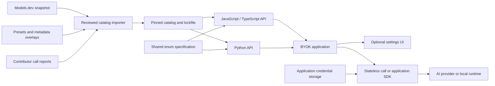

Models.dev supplies the broad metadata foundation. Reviewed overlays supply audience
presets and corrections; contributor reports supply evidence of particular calls.
The importer generates offline snapshots, change reports and hashes. Ordinary
queries and builds make no network requests. SDK releases and catalog revisions
can be reviewed separately.

Credentials stay in the application. Neither catalog metadata nor contributor
reports contain keys. Metadata refresh cannot launch inference, switch a saved
model, or redirect a key to a new endpoint. Stateless API execution is optional and explicitly invoked. Subscription
login and quota management belong to the application.

## Public query

```ts
import * as byokit from '@byokit/core/catalog';

const models=byokit.getModels({
  preset:byokit.Preset.Global,
  limit:10,
  filters:{input:[byokit.Modality.Text],requiredFeatures:[byokit.FeatureName.FunctionCalling]},
});
```

Each result is one provider/model offering enriched with provider, model, family,
logo and verification metadata. `byokit.Catalog(customData).getModels` uses another pinned
catalog. `byokit.Catalog.select` remains available for grouped menus. Python mirrors these
interfaces as `get_models` and `byokit.Catalog.get_models`.

## Selection flow

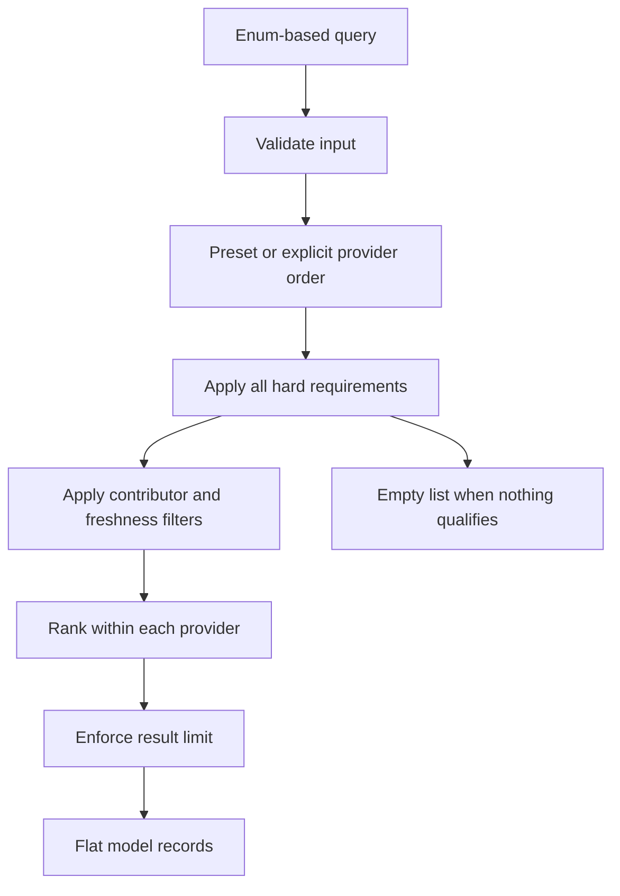

Provider order follows the preset or explicit provider list. Within a provider,
preferred supported features rank first, followed by optional input-token price,
curated rank and stable ID. Explicit providerIds and COMPLETE return all matching
LIVE hosted entries; default and region queries choose one per provider. An explicit
limit caps hosted results before local entries are appended.
Grouped UI menus have separate provider/model-per-provider limits.

Unknown metadata fails a requirement unless byokit.UnknownPolicy.Include permits it.
Conditional features do not satisfy unconditional requirements. Hard filters are
never relaxed to fill a list. Open weights, commercial permission, model origin,
endpoint location and account eligibility are distinct facts. Speed needs a sourced
measurement; model size does not establish speed or memory fit.

## Data relationships

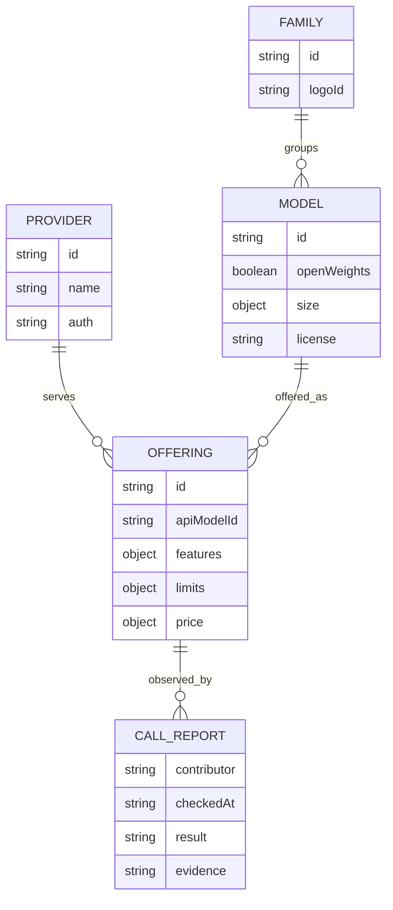

The offering holds provider-specific limits, costs and capabilities. The underlying
model holds identity, openness, license, size and architecture. Local discovery
creates deployment records with known artifact details while leaving unverified
limits/capabilities unknown. Family artwork can use a provider fallback.

## Enum and build-time contract

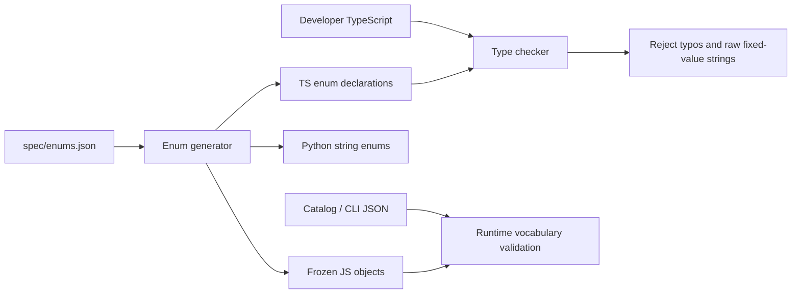

Fixed vocabularies include providers, presets, modalities, feature names and states,
deployment, authentication, context accounting, results and verification checks.
TS declarations use actual enums so even a correctly spelled raw string is rejected
where an enum is required. JS uses frozen objects with the same members and values.
Python uses str/Enum subclasses and a typed query configuration for type checkers.
JSON persists values as strings and is checked at runtime.

Open data such as model IDs, URLs, notes and custom tags cannot be exhaustively
listed in a permanent enum. Explicit branded helpers cover custom providers,
country codes, file formats, tags and contributor handles. Builds also emit runtime
OfferingId/ModelId enums and capability-specific ID enums for their pinned catalog.
Invalid enum members are compile-time errors; numeric token budgets need separate
build/runtime checks. Types cannot establish account access or dynamic request fit.

## Capability and context checks

Features use supported/unsupported/conditional/unknown with evidence. Text JSON is
separate from strict schema enforcement, and cache pricing is separate from cache
controls. A thinking feature does not imply that internal reasoning is available.
Input/output modalities and document formats are separate.

Context accounting can include output, exclude output, or be unknown. Input/output
limits are checked independently when known. Declared task budgets can fail CI;
actual requests need an application/provider-aware token counter. Estimates remain
estimates, including tool/media/reasoning overhead. No model substitution or history
truncation is automatic. Strict checks fail warnings when metadata is insufficient.

## Contributor verification

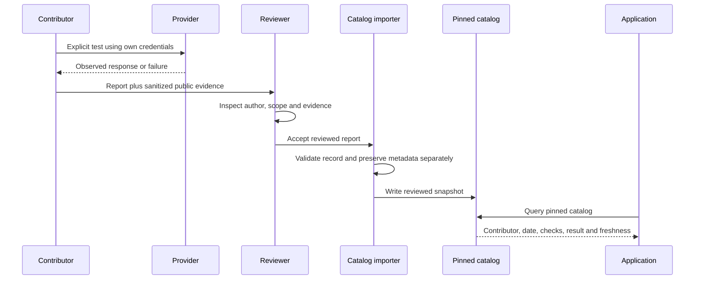

Reports name the exact offering, GitHub contributor, UTC date, adapter/version,
checks, result and evidence. GitHub handles are claims checked in PR review; parsing
JSON does not authenticate identity. No fabricated reports ship. Keys, headers and
private payload fields are not part of the report schema; notes/evidence still
require human review for sensitive content.

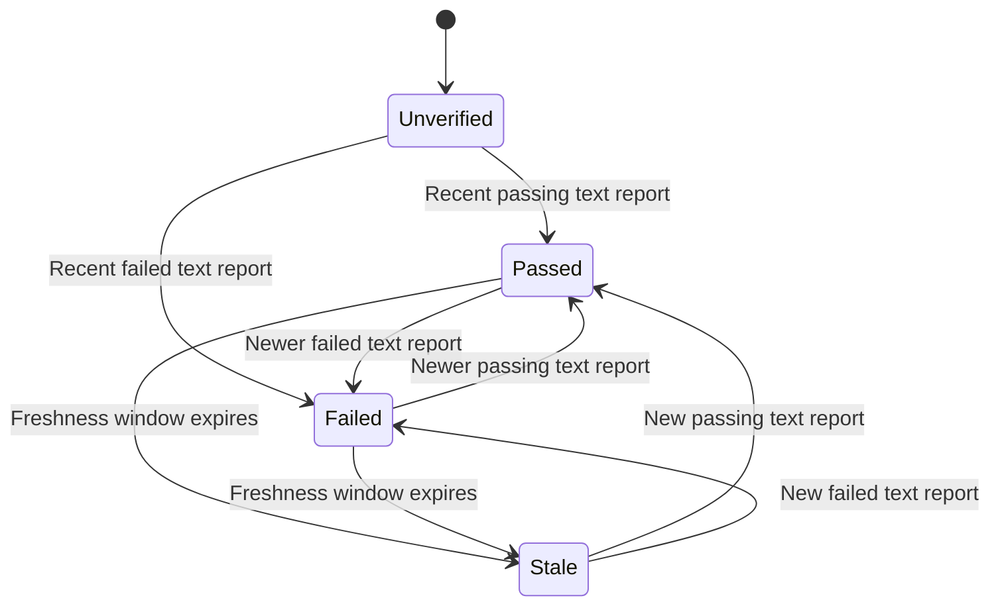

The latest eligible textGeneration report determines the summary, defaulting to a
90-day freshness window. verifiedBy scopes records to a contributor; asOf makes
checks reproducible. Future and feature-only reports cannot establish a text-call
pass. Later failures supersede earlier passes; records remain available. Reports
never upgrade capability tags and do not promise access for every account or region.

## Contributions and compatibility

Source edits belong in overlays, reports, or the shared enum spec, followed by
regeneration and tests. Preserve evidence and review removed models and changed
limits/prices. Missing overlay/report targets fail import. See CONTRIBUTING.md.

JS/TS and Python use the same JSON contract and conformance fixtures. Generated enum
values must agree in both languages. Schema-breaking changes need a new schemaVersion.
Additional languages can implement the contract without a Node/Python process or FFI.

The optional UI maintains isolated provider drafts, keeps credentials in a supplied
store, and fences stale async results. Explicit checks time out and support abort.
Unmount clears drafts; already-started host persistence cannot be rolled back.

Release checks cover TS invalid-call fixtures, runtime vocabulary checks, Python
parity, schema validation, query/report tests, builds and optional browser smoke.
Catalog candidates never auto-publish or rewrite application selections.

## Evidence-based lifecycle and popularity

Each offering can carry `lifecycleEvidence` and `popularityEvidence` in its
reviewed overlay. Query-time summaries have three states each:
LIVE / OUTDATED / UNCERTAIN and POPULAR / NOT_POPULAR / UNCERTAIN.
They are independent of release channel and contributor call verification.

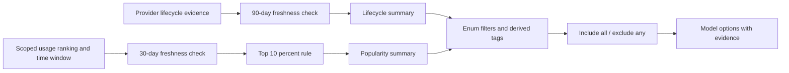

Missing, stale, or future-dated evidence becomes UNCERTAIN. Rank-based popularity
uses requests, tokens, or downloads within a complete named dataset; it is not a
global score. Existing picker `rank` never supplies popularity. Query `asOf`
makes freshness reproducible. Unknown-policy relaxation does not override explicit
lifecycle/popularity filters. These metadata additions are optional for older
catalogs; returned model options always contain both summaries. The bundled
snapshot includes explicitly dated Models.dev catalog-listing lifecycle evidence;
popularity remains UNCERTAIN without scoped usage rankings.

Tag matching combines provider, model, and offering tags. Exclusions win, and
reserved lifecycle/popularity tags are derived only from evidence, preventing
handwritten tags from claiming a model is live or popular. Queries are offline;
contributors supply dated evidence, while import validates its shape and preserves
observation dates. Future metric importers must preserve platform scope and may
not label models missing from a ranking as unpopular.

## Simple queries and local endpoints

`getModels()` chooses one LIVE offering from OpenAI, Anthropic, Google,
OpenRouter, and DeepSeek, then appends a Local setup entry. Typed `COMPLETE`,
`CHINA`, and `GLOBAL` shortcuts accept an optional second options argument.
COMPLETE considers every text-output offering from all supported providers, not
just a truncated per-provider snapshot. Explicit provider queries are unbounded;
region/default queries use one model per provider. A hosted limit applies before
local append. Grouped UI selection still uses its configured display caps.

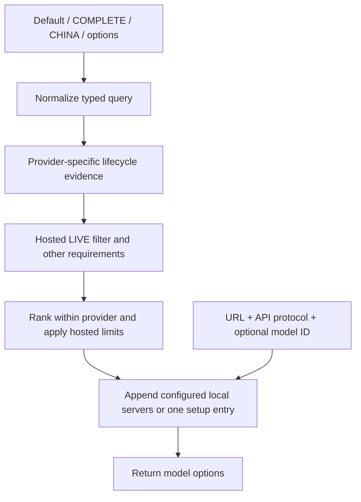

A current upstream snapshot explicitly recorded at download time can provide
`basis: catalog-listing` lifecycle evidence. It does not verify provider execution
or account entitlement. Provider reviews can override it with `basis: provider`.
`--observed-at` belongs to the snapshot observation, not the import clock. Reimports
without a new observation reuse the timestamp only if the source hash matches;
an unobserved new file yields UNCERTAIN. No inference is run during import.

Hosted LIVE is default across queries and pickers; explicit lifecycle filters
allow inspection of retired/uncertain records. Local setup/configuration entries
are separate and bypass tag, popularity, lifecycle, cost, and capability filters.
`local: false`, an empty local list, or hosted-only deployment removes them.
Local entries preserve unknown capabilities and are not labeled LIVE just because
a URL is configured. Inference belongs to the host's protocol adapter.

Local discovery accepts OpenAI-compatible or native Ollama API protocols rather
than requiring a runtime brand. OpenAI-compatible `/v1/models` works for Ollama,
vLLM, and llama.cpp servers; native Ollama distinguishes installed `/api/tags`
from running `/api/ps`. Discovery remains explicit, loopback by default, and
bounded. An unavailable saved hosted model is shown as a disabled recovery prompt
instead of being restored to the selectable list or silently replaced.

## Stateless calls

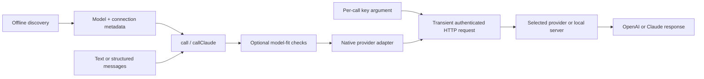

Discovery, catalog refresh and builds never trigger inference. The call layer
owns only one request at a time, with no cached clients, credentials, automatic
retry or tool execution. Connection metadata is derived from the provider or
explicit local endpoint; API model IDs remain offering-specific.

OpenAI and Claude public request/response formats are translated through a
shared internal representation. Non-streaming text, system messages and tools
are supported; unrepresentable fields are rejected. Native thinking signatures
and multimedia are outside this version. Response usage fields are included
only when reported, rather than fabricated.

Runtime checks reuse checkFit; missing input counts warn rather than pretending
to guarantee fit. runtimeChecks=false skips model-fit checks, not shape/URL
validation. Build task budgets are checked offline; missing budgets warn and
strict validation can fail warnings. Dynamic input budgets remain runtime work.

Authentication headers use a per-call key transiently. They are excluded from
results, diagnostics, records and logs. Redirects are blocked. Browser CORS
restrictions remain provider-owned. Cancellation and a 90-second deadline
terminate calls without retry; spent provider quota cannot be refunded.

## Reusable protocol clients

The public SDKs are `new byokit.OpenAI({baseURL, apiKey, defaultHeaders})` and
`new byokit.Anthropic({baseURL, apiKey, defaultHeaders})`. Model IDs belong to each
request; endpoint, protocol and account belong to the client. Python uses
`OpenAI`/`Anthropic` with `base_url`, `api_key`, `default_headers` and SDK-style
attribute responses (also mappings). See [SDK guide](sdk.md) for full contracts,
optional official SDK integration, validation and migration.

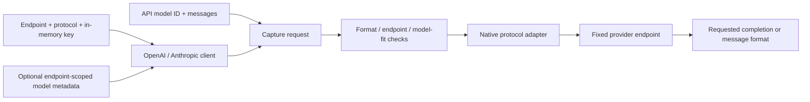

Clients reuse their key from memory. They perform no persistence or telemetry.
Headers are validated and copied; auth and transport headers cannot be overridden.
Redirects are blocked. Per-request destinations and credentials are not accepted.
Metadata must match the exact endpoint/protocol and model ID; unknown IDs never
inherit another model's limits. Calls have independent cancellation, no retries,
and the same default budgets/timeouts as standalone `call()`/`callClaude()`.

The class chooses the public format, while the named protocol is its wire-format
default. An explicit `protocol` enum override enables native adapter translation
for Gemini/Ollama and other supported protocols. This extension is byokit-specific;
pointing an official SDK at a different native API does not translate protocols.
Optional official SDKs remain application dependencies; discovery is offline.

Legacy callback factories/bound-model constructors and the per-request `Byokit`
client remain available for migration, marked deprecated in docs/types. The
stateless convenience helpers remain supported.

## Website uses the library

The explorer and hero provider list query the bundled `getModels()` API. Browser
verification uses the same `OpenAI` client, adapters and request validator as
applications. The website imports provider endpoints from `connection.js`; it
has no separately maintained endpoint list. Display labels and documentation links
remain website concerns.

Catalogs are pinned for reproducible offline queries. Catalog refresh + application
release updates model options without changes to model-list code. An application
must consume an updated catalog/package; this does not claim live background
refresh or account-level availability guarantees.

## Website verification publication

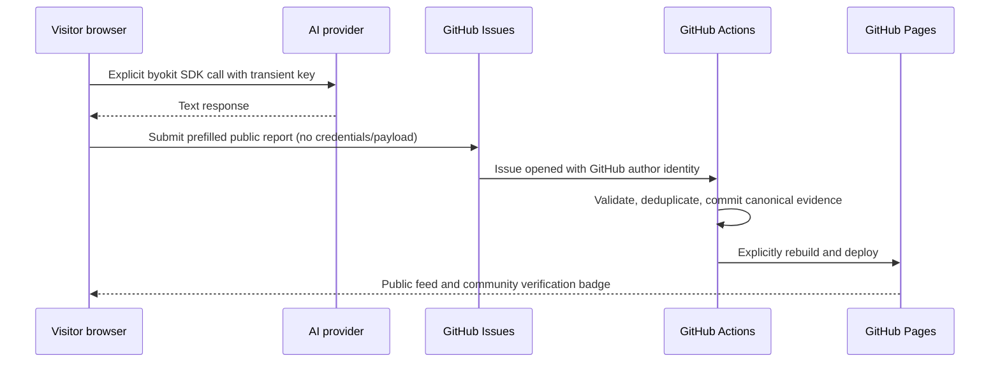

The issue supplies authenticated authorship; inference remains community-reported.
No OAuth service or GitHub App is involved. Existing verification schemas and
90-day freshness stay compatible. Provider-specific community status is separate
from upstream lifecycle. Failures remain browser-local. Staging exercises the
publication pipeline through separate receipts without adding model evidence.

## Direct calls, model metadata, and batch verification

The concise inference entry point is `byokit.call(model, prompt, api_key)`;
Reusable OpenAI/Anthropic clients use constructor credentials. Website inference uses this shared
call adapter, never a separate provider implementation. Catalog offerings expose
optional `releaseDate` (YYYY-MM-DD/null) from the pinned upstream snapshot and
provider-specific `speed.tokensPerSecond` with evidence; missing speed is unknown.
A tiny text verification is not treated as a generation-throughput benchmark.

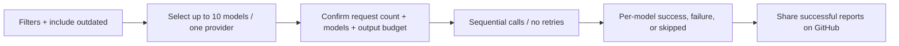

Canceling confirmation sends no requests. Canceling or editing execution settings
aborts the running request and remaining queue. Authentication, quota, network,
and timeout failures stop the queue; unavailable models can fail independently.
Keys are supplied transiently from the provider's form entry and never saved with
results. Batch results preserve provider-specific IDs and require explicit sharing
per successful model; the publication limits and badge rules are unchanged.

Global includes all supported providers. Exclude origin:cn with filters.excludeTags to omit China-origin providers/models; missing origin remains unknown.

The former NON_CHINA/NonChina API has been removed. Migrate to GLOBAL for an inclusive shortlist or COMPLETE with filters.excludeTags: [Tag.OriginChina] for origin exclusions. Both languages use the same catalog and enum vocabulary.

## Query ordering and custom catalogs

`getModels` sorts hosted results alphabetically by model name before `limit` by
default (`ModelSort.AlphabeticalAscend`); `AlphabeticalDescend` reverses names.
`PriceAscend`/`PriceDescend` sort input USD/million; `SpeedAscend`/`SpeedDescend`
sort known tokens/sec. Unknowns stay last in both directions; ties use ascending
name/provider/offering ID. Legacy `Alphabetical`, `Price`, and `Speed` enum members
and serialized values retain their previous ordering for compatibility. Local setup
entries remain appended. Shortlist selection still precedes sorting. Explicit
`ProviderOrder` retains prior ranking for UI use cases. Python follows the same
ordering and enum values. `appendModel` adds an unverified application-owned model
to an immutable list without applying filters or catalog evidence.

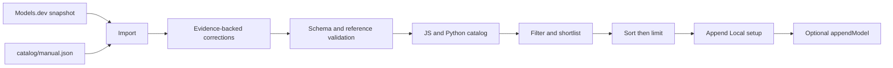

Nightly Actions fetches a new snapshot and emits a validated candidate artifact.
Manual evidence is never freshened by upstream observation timestamps. Production
publication and package releases remain explicit. See custom-catalog.md.

## JavaScript playground

The website includes editable JS examples for discovery, sorting, filtering,
custom models, and full metadata. The build uses the existing TypeScript dev
dependency to compile the same core modules and pinned catalog into a lazy-loaded
worker source; there is no browser compiler dependency or separate sample catalog.

Each Run starts a fresh Worker inside a sandboxed opaque-origin iframe. Its CSP
blocks network requests, external scripts, and imports. Inference clients are
excluded from the exposed byokit namespace; real calls use the verification page.
Code never runs in the host page, receives no keys, and is not persisted. Console
output is rendered as text, bounded, and includes errors and returned values.
Stop, edits, reset, page exit, or a three-second deadline remove the frame and
terminate its work. Run identity checks fence late messages. CI exercises actual
Chromium worker execution, errors, stop/timeouts, network blocking, and recovery.


Verification selectors live in the table header alongside their data columns:
provider/model, context, price, speed/release, tags/capabilities and status.
The header remains visible as a responsive filter grid above mobile result cards;
it is never removed with the desktop header labels. Missing price, speed and release
metadata is displayed as unknown. More tags expand on demand. All list filters and
sort directions delegate to the shared catalog API; newest-release ordering remains
a website view option. Changing table filters sends no inference request.


Website builds version HTML asset references and relative JavaScript module imports
with one content digest. This keeps cached UI code, enums, adapters, styles, and
catalog snapshots in the same deployment; it does not trigger live discovery or
change the public verification feed. Bundled canonical verification records render
immediately, while successful feed refreshes replace that snapshot.
